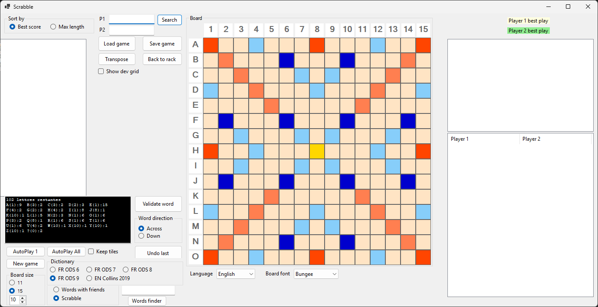
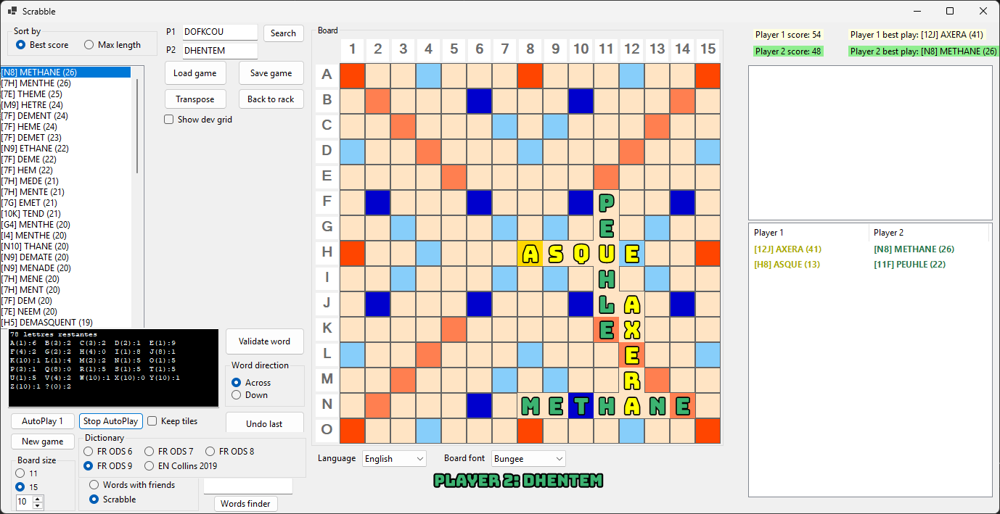
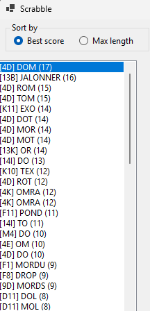
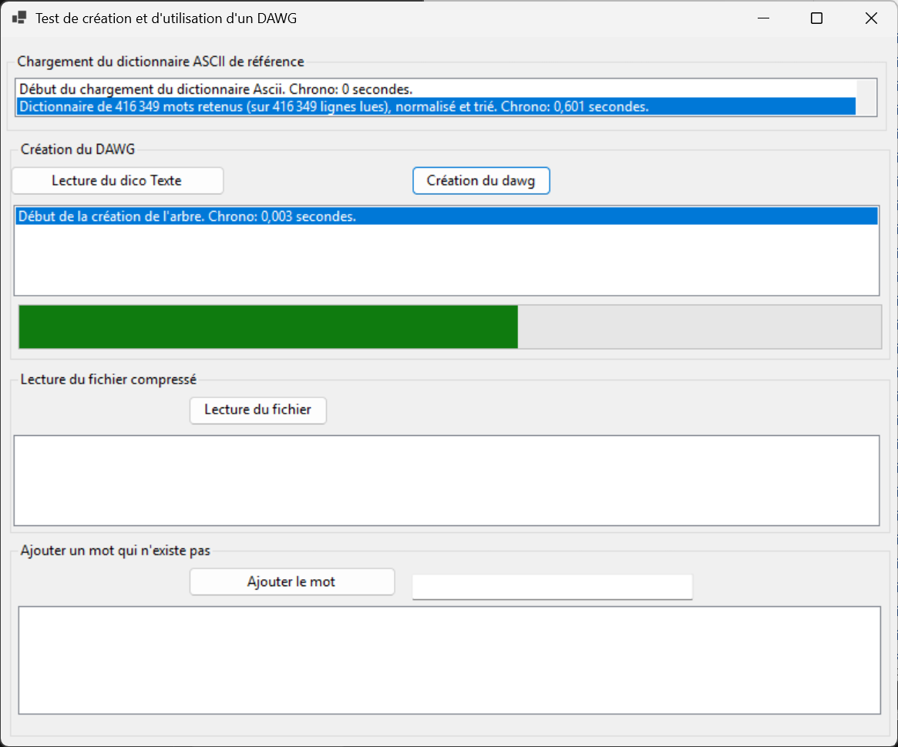

# Sharp Scrabble Solver

A Scrabble solver and auto-player written in C# (.NET 10, WinForms).
It finds the best moves on a real 15×15 board using a **DAWG** (Directed Acyclic Word Graph)
and the classic *anchor / cross-check* algorithm (Appel & Jacobson), plays full games on its own,
and includes a stand-alone word finder (anagrams and patterns).



## Features

- **Best-move search** for the current rack: every legal placement, across and down,
  with exact scoring (letter / word multipliers, cross-words, 50-point bingo bonus).
  Results can be sorted by best score or by word length.
- **AutoPlay 1 / AutoPlay All**: the computer plays one move, or a whole two-player game,
  with an end-of-game count of the tiles left on the racks (official rules).
- **Dictionaries**: French **ODS6, ODS7, ODS8, ODS9** (ODS9 by default) and English **Collins 2019**.
- **Word finder** (independent of the board): anagrams of a rack with blanks, and pattern search.
- **Board editing**: type letters directly on the board to set up a position, then let the solver play
  ("Keep tiles" makes *AutoPlay All* continue from the current board).
- **Move history** in two columns (Player 1 / Player 2). Click a word to highlight it on the board,
  double-click it to open its definition, click a column header to change that player's colour.
- **Styled board letters**: outlined letters filled with each player's colour, with a choice of
  5 free fonts (SIL OFL / Apache 2.0) or the standard Windows font.
- **Resizable board**: the board and its tiles grow with the window.
- **English / French interface**, switchable at run time.
- **Persistent settings** (dictionary, language, colours, fonts) in
  `%AppData%\ScrabbleSolver\settings.json`.
- **Save / load** games.

## Screenshots

| Auto-play in progress | Word finder |
|---|---|
|  |  |

| Move search for the current rack | DAWG builder |
|---|---|
|  |  |

## Getting started

### Requirements

- Windows 10 / 11
- [.NET 10 SDK](https://dotnet.microsoft.com/download)
- A recent Visual Studio with .NET 10 support (*.NET desktop development* workload), or just the `dotnet` CLI

### Build and run

```powershell
git clone https://github.com/xavave/Sharp-Scrabble-Solver.git
cd Sharp-Scrabble-Solver
dotnet build ScrabbleSolver.sln -c Release
dotnet run --project Dawg.Resolver.Winform.Test
```

Or open `ScrabbleSolver.sln` in Visual Studio and start **Dawg.Solver.Winform**.

## How to use

### Find the best move

1. Choose a dictionary (ODS9 is selected by default).
2. Type your letters in the **P1** rack and click **Search**.
3. The list shows every legal move with its position and score, e.g. `[H4] BONJOUR (24)`.
   Click a move to preview it on the board, then **Validate word** to play it.

### Let the computer play

- **AutoPlay 1** plays the best move for the player whose turn it is.
- **AutoPlay All** plays a complete game between Player 1 and Player 2. Click it again to stop.
  The game ends as soon as a player has used all their tiles with the bag empty
  (the opponent's remaining tiles are added to that player's score), or when both players pass.
- Tick **Keep tiles** to continue from the current board instead of starting a new game.

### Word finder

Open **Words finder** from the main window.

| Field | Meaning |
|---|---|
| **Letters** | Your rack. Each letter can be used once; `?` is a blank (shown in lowercase, worth 0). Leave empty to allow any letter. |
| **Pattern** | Optional. A letter is fixed at its position, `?` is one free square, `*` is zero or more squares. |
| **Length** | Word length, `0` = any length. |
| **Use all letters** | Only words that use the whole rack (bingos). |

Examples: letters `AEINRST` alone gives all anagrams; pattern `B??JOUR` gives *BONJOUR*;
letters `ONAT` + pattern `*TION` gives *NOTATION*, *NATION*, *NOTION*.
Double-click a word to open its definition.

## Solution layout

| Project | Description |
|---|---|
| `Dawg` | DAWG dictionary: loading, word lookup, building (`net10.0`). |
| `Dawg.Resolver.Winform.Test` | **Main WinForms application** (`Dawg.Solver.Winform`, `net10.0-windows`): board, solver, auto-play, word finder. |
| `DawgBuilder` | Tool that converts a plain word list (one word per line) into a DAWG file. |
| `DawgResolver` / `DawgResolverTest` | Solver library and console test. |
| `Gaddag`, `Scrabble`, `Scrabble2018`, `Dawg.Resolver.WPF`, `legacyVBAscramble` | Older experiments, kept for reference. |

### Dictionaries

DAWG files live in `Dawg/Resources/` (`dico_dawgODS6.txt` … `dico_dawgODS9.txt`, `EN_Collins_dawg.txt`)
and are embedded in the build. To add or update a dictionary, run **DawgBuilder**, load a word list
(for example *French ODS 9 dictionary.txt*) and save the result as `dico_dawgODSx.txt`.
Words are normalised (upper case, accents removed) during the conversion.

### Fonts

The board fonts (Titan One, Bowlby One, Bungee, Lilita One, Luckiest Guy) are free fonts embedded
from `Dawg.Resolver.Winform.Test/Resources/Fonts`, with their licences in the `licenses` sub-folder.

## Troubleshooting

- A log of the last session is written next to the executable: `scrabble.log`.
- To reset all settings, delete `%AppData%\ScrabbleSolver\settings.json`.

## Version française (résumé)

Solveur de Scrabble en C# / .NET 10 (WinForms) : recherche des meilleurs coups sur le plateau,
partie automatique à deux joueurs, chercheur de mots (anagrammes, jokers `?`, motifs `?` et `*`),
dictionnaires ODS6 à ODS9 et Collins 2019, interface français / anglais, lettres stylées aux couleurs
des joueurs et plateau redimensionnable. Compilation : `dotnet build ScrabbleSolver.sln`, puis lancer
le projet **Dawg.Solver.Winform**. Les détails des corrections et de la migration sont dans
[ANALYSE_CORRECTIONS.md](ANALYSE_CORRECTIONS.md) et [MIGRATION_NET10.md](MIGRATION_NET10.md).

## License

The board fonts are distributed under their own licences (SIL Open Font License 1.1 / Apache 2.0),
see `Dawg.Resolver.Winform.Test/Resources/Fonts/licenses`.
